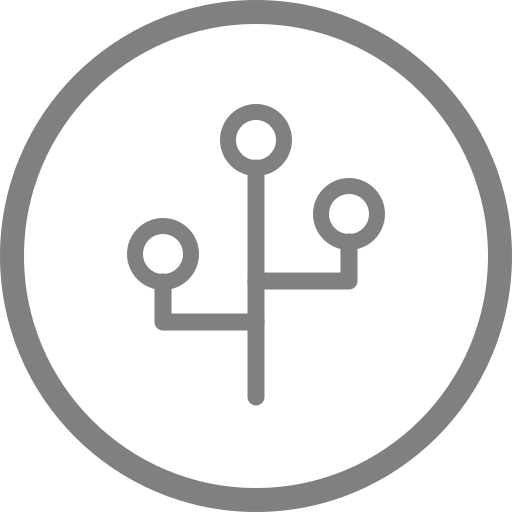

# HA-CoAP Fleet Manager

One application for Windows, macOS and Linux to look after a fleet of ha-coap devices. It finds them on the network, shows their status, draws the Thread mesh they form, builds firmware with the settings you choose, keeps a library of firmware images, and updates devices over the air or over USB.

It runs on your PC when you need it, or always on a server (see [Running it on a server](#running-it-on-a-server)). The app starts a small web server that only this computer can reach (`http://127.0.0.1:8710`), and opens it in your browser; your phone or another computer can open it too, after signing in, once you allow it (Settings → **Other devices**). Close the app's window and everything stops.

**Status (2026-10-26):** version 0.1.0, the plan's phases 0–2, 5 and 6 (foundations, inventory, updates, builds, backups and releases), plus a dashboard, device pages with history charts and plant photos, groups, staged updates with signature and battery checks, alerts, a network map with each board's plant and readings, a floor plan, a signal heatmap, network history, a channel scan, a serial console, one-click setup of a new computer, flashing new boards over SWD, a connection check, battery drain per firmware, Home Assistant history import, labels, running in the background, watering forecasts, a photo timeline per plant, a wall display, a weekly summary, and a built-in demo. Tested against simulated devices and a simulated border router on Windows, macOS and Linux, and a real firmware build on Windows, **not yet with real boards, a real border router or a J-Link**. Since then: a board's settings changed from the app, its restarts and crashes, and its log over the air (firmware changes, see the main README). Commissioning comes later (see [the plan](../docs/FLEET-MANAGER-PLAN.md)). Until it has updated real boards, keep using the scripts or the web updater for anything important.

## Getting it

**Packaged app** (no Python needed):
1. Download it:
   - **From a release** (once one is published): the repository's **Releases** page, a `Fleet manager <version>` release, then `hacoap-manager-<version>-<platform>.zip` for Windows (x64), macOS (Apple silicon), Linux (x64) or Linux on ARM (Raspberry Pi 4/5 with a 64-bit OS).
   - **From the latest build of the branch:** the repository's **Actions** tab, the latest **Build firmware** run on the `fleet-manager` branch, then under **Artifacts** `hacoap-manager-Windows-…`, `-macOS-…` or `-Linux-…`.
2. Unzip it.
3. Run it:
   - **Windows:** double-click `hacoap-manager.exe`. SmartScreen warns about an unknown publisher the first time: **More info → Run anyway**.
   - **macOS:** in Terminal, `chmod +x hacoap-manager && xattr -d com.apple.quarantine hacoap-manager && ./hacoap-manager`. Gatekeeper otherwise blocks an unsigned download.
   - **Linux:** `chmod +x hacoap-manager && ./hacoap-manager`.

The app isn't code-signed, which is why each OS warns once.

**From the source** (Python 3.10 or newer), from this folder:

| | Set up once | Start |
|---|---|---|
| Windows (PowerShell) | `py -m venv .venv` then `.venv\Scripts\pip install -r requirements.txt` | `.venv\Scripts\python -m hacoap_manager` |
| macOS, Linux | `python3 -m venv .venv` then `.venv/bin/pip install -r requirements.txt` | `.venv/bin/python -m hacoap_manager` |

**As an app window:** in Edge or Chrome, the page offers to **install** itself (the icon at the right of the address bar, or the browser's menu → Apps → Install). It then opens in its own window with the ha-coap icon, from the Start menu or the dock, like a desktop program. It's still the same page on this computer: the app must be running.

Options: `--port 8710` (the next free port is used if it's taken), `--data-dir <folder>`, `--no-browser`, `--background` (no browser and no window; it logs to `hacoap-manager.log` in the data folder), `--workdir <folder>` (work from this folder, such as the ha-coap-server checkout), `--demo` (the demo, see below). Starting the app while it already runs (same data folder) opens the running one in the browser instead of starting a second.

## Before you use it
- **Same network as the border router.** The PC reaches the devices through the border router, exactly like the scripts: CoAP on UDP 5683 for status, mcumgr on UDP 1337 for updates, and mDNS to find them. If `ping` to a device's address fails from this PC, the app can't reach it either.
- **Check my connection** (Devices tab) checks each step from this PC to the boards, and says which one fails and what usually fixes it. Run it first on a new PC or network (see Devices below).
- **Images signed with your key.** Build on the PC that has `application/keys/mcuboot-signing-key.pem` (see the main README). An image signed with another key uploads fine, but the board refuses to boot it, and the app reports that MCUboot reverted the update.

## Using it

The look follows [Omarchy](https://omarchy.org/): a terminal feel, JetBrains Mono, and its colour themes, with the ha-coap logo and Home Assistant's blue as the accent in every theme. Icons ([Lucide](https://lucide.dev), bundled with the app) mark the tabs, the status bar and the map. The dashboard's tiles have an icon and, for online, needs water, low battery and weak links, a small chart of the last 7 days. Tabs fade in, and cards show a shimmering placeholder while they load. Motion tells what just happened on a board: a reading that changes counts to its new value and flashes (the soil gauges sweep to it); a button that asks a board something (**Beep**, **Refresh**, **Run the pump**, **Read from the board**…) says "waiting for the board…" with a ring that fills over its poll period, as a sleepy board answers at its next poll, then a check; and the board's card, row and page pulse when it answers, at a refresh too. While the pump runs (started from the app), drops fall over the plant's photo with the seconds left. Cards slide to their new place when you sort or filter. A finished update's last step draws its check, and a board's firmware badge flips to the new one. None of this with "reduce motion" set in the OS. Everything works from the keyboard: a visible outline shows where you are, and on the network map **Tab** goes from node to node (lighting up each one's way to the border router) and **Enter** opens one. Text meets the WCAG contrast ratio of 4.5:1 in every theme. Tokyo Night is the default; pick another from the menu at the top right, or press **T** to cycle through them (**Shift+T** goes back). **System**, at the top of that menu, follows the computer's light or dark setting (Tokyo Night by dark, White by light), and switches when the computer does. The browser remembers the choice, and `?theme=gruvbox` in the address picks one too. Keys **1** to **9**, then **0**, switch tabs, and **?** shows all the keyboard shortcuts. **Ctrl+K** (or **search** at the top) jumps to any tab or device, or runs an action (Find devices, Read the network, download a backup, and so on): type a few letters, then Enter. The status bar at the bottom shows the connection to the app, how many devices are online, what's running (an update's progress, a paused update, a build, a setup step, the console), the open alerts, and a newer version of the app if there is one.

On a phone (over Remote Desktop, say) the layout narrows: the tabs show in rows of three (on a narrow window, on their own row under the logo), and two fingers pinch to zoom the network map.

**Simple and advanced.** The app opens on its **simple view**, made for a phone: your plants and little else, with three tabs at the bottom.

- **Plants:** a card per plant, each with a ring around its photo (or the logo) that fills with the battery (as on the wall display), its soil moisture and when it will need water. The ones that need water come first, with a banner naming them.
- **A plant** (tap its card): named by what you called it (its plant field), with the board's own name small under it, and **Rename**; its soil with the watering target, **Water now** (choose how long, 1 to 9 s, with its last run time marked, then confirm "Water ha-coap-9 for 5 seconds?") and **Beep**, its battery (and how long it lasts, or that it's charging), air and signal, and its soil over the last 7 days. **Advanced details** opens its full device page.
- **Alerts:** the open alerts, with their count on the tab, and what happened lately.
- **Settings:** the colour theme, notifications, the wall display and weekly summary, and the way to the advanced view.

The **advanced view** is everything below: the tabs at the top, the status bar, every tool. **Simple | Advanced** at the top of the simple view and **simple view** at the top of the advanced one switch between them, and the browser remembers which you used last. A link to an advanced page (`#devices`, `#device/<id>`…) opens the advanced view; `#plants`, `#plant/<id>`, `#alerts` and `#more` open the simple one; `#home` opens the first page of the current one.

**Dashboard.** The fleet at a glance. On a new setup, a **Getting started** list comes first: check the connection, find your boards, read the network, mark the release, add a plant photo, start with the computer. Each step ticks itself off; **Hide this** puts it away. **Wall display** and **Weekly summary** (top right) open the pages below.
- **Tiles:**
  - devices online
  - plants that need water
  - devices behind the release
  - devices whose firmware was never read
  - low batteries
  - weak links
- **Needs water:** the plants whose soil is under their target, the driest first, with **Run the pump** for each. Under **Soon**, the ones that will be within 3 days, from how fast their soil has dried since they were last watered (a jump of 5 % or more up counts as a watering).
- **Alerts:** what needs attention (see Alerts below), each with its time and a button to dismiss it.
- **Firmware:** how many devices run each image, with the release marked. **Update the N behind…** starts a staged update of those devices (see Updates), and **Read all firmware** asks every device which image it runs.
- **Batteries:** the lowest first, with the days left at the current rate. The estimate is a straight line through the last 14 days of readings. It needs at least three readings over six hours, and a battery that is actually going down. A board on USB power (newer firmware says so) isn't listed, and its readings while plugged in count neither here nor in the drain below.
- **Battery drain by firmware:** how fast batteries go down under each image, as % per day (the median of the devices that ran it) and how long a full battery would last at that rate. Point at a row for each device's rate. It tells whether an update changed the battery life, such as the power changes of the `claude` branch. How it's measured: each device's readings are split at its updates (the 2 hours after an update are left out, the update itself draws power), and at any jump that isn't drain (a rise from charging, or the sudden drop when the charger is unplugged); a straight line through each stretch of 3 readings or more over 6 hours gives the rate. Readings from before a device's first update made here count for "the image before its first update". A device never updated from the app counts for the image it runs now.
- **Offline:** devices that stopped answering.
- **Restarts (7 days):** the boards that restarted, how many times, how many for a bad reason (a crash, the watchdog, a CPU lockup), and the last one's cause. From boards whose firmware reports it (`diag`, see the main README).
- **Weakest links:** from the last network read.
- **Activity:** everything that happened, newest first: updates (and failed ones), alerts, parent changes, pump runs started from the app, board restarts, settings changed on a board, plant photos and builds, each linking to its device. **older** goes further back.
- **Recent updates.**

**Devices.** **Find devices** asks the network for every `ha-coap-*` device (the border router answers for them). Boards with newer firmware also say what they run (their TXT records), which fills in their firmware and hardware at once. It also happens by itself when a board stops answering. A new border router gives every board a new address, so the app browses the network again: once for all the boards that went quiet together, at most every 5 minutes. It then asks a board that moved at its new address, and notes the change in its timeline. You can also add one by its IPv6 address. Each device shows:
- its firmware (the git commit, from `info`)
- the running image's version and hash, once read over mcumgr
- its battery, soil and air readings
- when it last answered

The status refreshes every 15 minutes while the app runs, or with **Refresh all**. **table** or **cards** (top right of the list) switches between the table and a grid of plant cards: each with its photo, a soil gauge (its watering target marked), the battery, when it needs water, when it was last seen, and **behind** when it doesn't run the release. **sort** orders either one by name, needs water soonest, driest first, lowest battery, or last seen. The browser remembers both. Each device's **Actions** menu has:
- Open (its page)
- Refresh
- Firmware slots (what mcumgr reports)
- Update history
- Beep
- Rename
- Notes
- Remove from the list (it comes back with **Find devices**). It goes at once, with **Undo** for 8 seconds; the same for **With selected → Remove from the list**, and for dismissing an alert

- **Check my connection** walks the path from this PC to the boards, one step at a time:
  1. **Border router:** its REST API answers (when its address is set).
  2. **Finding boards (mDNS):** the border router answers for the boards on your LAN.
  3. **Route to the Thread network:** this PC has a route to each Thread prefix the boards use (from the border router's router advertisements).
  4. **Boards answering:** each board (up to 24, four at a time) answers CoAP and mcumgr, and how fast. The first mcumgr answer can wait for a sleepy board's next poll; the second shows the speed during an update, from which it estimates the upload time of the release image.

  A failed step comes with what usually fixes it: the REST API only listening on the border router itself, mDNS blocked by Wi-Fi client isolation or a firewall, Linux not accepting the route (`accept_ra_rt_info_max_plen`), and so on. A device's page has the same check for that one board.
- **Print labels…** prints a label per device (the ticked ones, or all) with the logo, its name, plant, location and device ID: on an A4 sheet of 21 (63.5 × 38.1 mm, Avery L7160), a US Letter sheet of 30 (66.7 × 25.4 mm, Avery 5160), or one per page for a label printer (62 × 29 mm). In the print dialog, keep the scale at 100 % and the margins as set (default), so the labels land on the sheet's.

**health** (next to table and cards) shows a row per board to spot the one that struggles: its restarts this week (and how many for a bad reason), whether its name is registered with the border router, its signal to its parent, its battery and how fast it drains under the image it runs, and its firmware against the release. Click a column to sort by it.

Tick devices to update them, or to use **With selected**: refresh them, read their firmware, beep, add them to a group or remove them from one, set their location or watering target, change the boards' own settings (**Change the boards' settings…**: the same values on all of them, over the air, one after the other, each one's result shown; empty fields keep each board's own), or remove them from the list, all at once.

- **Groups:** give devices a location and tags (on the device's page, under **About this device**, for example `kitchen` and `herbs`). Click a tag above the list to show only those devices, then tick them all to update one group at a time. The filter box searches names, IDs, addresses, plants, locations, tags and notes.
- **Firmware column:** a badge says whether each device runs the release, an older or other image, or has never been read. **Read all firmware** reads them all.
- **Plants:** a device with a photo shows it next to its name, and a **needs water** badge when its soil is under its target.

**A device's page.** Click a device's name. At the top: the plant's photo, its soil as a big gauge (the watering target marked), and the numbers that matter: when it needs water, the battery and how long it lasts, its signal to its parent, the air temperature and humidity; with **Run the pump**, **Beep** and **Refresh**. Then:
- **Plant:** photos of the plant it looks after, over time, shown at the top of the page. **Add a photo** adds one (from a phone, too; big photos are shrunk to 1600 pixels before they're sent), dated by the file's date, so a photo taken last week lands last week. With two or more, a slider steps through them in the photo at the top: each with its date, the soil moisture then, and the soil chart with that date marked; watch the plant grow next to its readings. **Remove this one** removes the photo shown. The newest is the device's photo everywhere else. Then: whether it needs water, when it will at its drying rate ("in about 2 days"), and what a pump run does ("a pump run of 3 s raises its soil by about 17 %", from the runs started from the app over 90 days: tune the run time with it).
- **Status:** its readings, and the days of battery left.
- **Firmware:** what it runs, compared with the release.
- **Controls:**
  - **Run the pump**, **Stop**, and the pump's run time (1 to 9 s)
  - **Beep**

  A command reaches a sleeping board at its next poll: up to 3 s.
- **Health** (from boards whose firmware reports it, read at every refresh): how long it has been running, why it last restarted (power on, the reset button, a software reset such as after an update, the watchdog, a CPU lockup, or a crash, with the fatal error and its address), its number of boots, its parent and its signal as the board measures it, its own short address, and **its name**: whether its registration with the border router (SRP, which makes it findable in Home Assistant and here) succeeds. "The border router refuses it" usually means another key holds that name: see the main README, SRP registration. Under it, its restarts as the app saw them. Several restarts between two refreshes show as one entry ("3 restarts since the last check"), with the last one's cause. A crash, a watchdog reset or a lockup also raises an alert. Older firmware doesn't report this: the card says so, and the app stops asking it until the board runs another firmware.
- **Settings on the board:** settings the board keeps in its flash, through restarts and updates, that change without a new firmware: the sampling period, the pump run time, the poll period, and the soil sensor's calibration (its output when dry and when wet). **Read from the board** shows them, each with its range and default (over the air, or over USB when the board was last seen on a serial port). Change some and **Save on the board**: the board takes all of them or none (it refuses a value out of range, or a dry value at or below the wet one). **Defaults** fills in the firmware's defaults (then Save). Each change goes in the activity feed. Reading or saving makes the board poll fast for 30 s, like an update. To calibrate the soil sensor: put it in dry soil, **Measure now** (the board takes a sample at once and the card shows its output in mV), **Use as dry**; then in a glass of water, **Measure now**, **Use as wet**; then **Save on the board**. Readings use the new calibration from the board's next sample. Older firmware has no settings to change: the card says so. **Forget its network…** makes the board forget its Thread network and restart, to move it to another one: it drops off until a commissioner lets it join again (it keeps trying, see the main README's Joining a Thread network); its settings stay.
- **About this device:** name, plant, location, tags, notes, and **Needs water below**: the soil moisture % under which this plant needs water. Empty uses the default from Settings (30 %). Type a plant and the app suggests the usual target for it (about 30 plants: herbs, vegetables, houseplants, succulents), with **Use it**: a guide to start from, adjust it once you see the plant's readings.
- **History:** **CSV** downloads every reading of the device as a spreadsheet. Its **battery drain by firmware** (see the dashboard), then charts of battery, soil moisture, air humidity, temperature and the link to its parent, over 1, 7, 30 or 90 days, and which parents it had. Every refresh and every network read adds a point, so the charts fill in while the app runs (or import Home Assistant's history, see Settings). Point at a chart to read its values at that time; drag across one to zoom every chart into that period (**whole period** goes back). **compare** draws up to three other plants on the same charts (dashed), to compare their soil, battery, humidity and temperature. Markers on the charts show what happened: updates (and failed ones) and restarts on the battery chart, updates on the link chart too, pump runs started from the app on the soil chart, and parent changes on the link chart. Point at one for when and what.
- **Timeline:** everything that happened to the board, newest first, by day: its updates (with the image, how, and the result), restarts, pump runs from the app, settings changes, parent changes and its network forgotten, plant photos and alerts. The buttons above filter it by kind, with how many of each.

**Images.** The library of firmware images. You can add an `app_update.bin` file, or add a build from this computer: when the app runs from the ha-coap-server folder, it lists `application/build*/zephyr/app_update.bin`. Images are identified by their SHA-256 hash, the same one `mcumgr image list` shows. Their version comes from `application/VERSION` (bump it before building a release), and an image built here also records its git commit. Mark one image as the **release**: the image your fleet should run. The dashboard and the device list compare every device with it.

The **Signed** column says who signed each image. The app checks the image's signature against your signing key:
- **your key:** boards with your bootloader boot it.
- **dev key:** signed with MCUboot's public development key, which every build uses when there's no private key. Your boards refuse it.
- **other key:** someone else's key. Your boards refuse it.
- **unsigned:** real boards refuse it. The simulator takes it.
- **not checked:** this computer has never seen your key.

The app keeps the public half of your key in its data folder (it isn't secret), so the check also works on a computer without the private key, once the app has run where the key is. Backups carry it too.

**Network.** A map of the Thread network, read from your border router's REST API (ot-br-posix, port 8081). Set its address behind the gear (top right of the page, for example `http://192.168.1.20:8081`), or click **Find it on the network** there (the app looks for border routers on the LAN), then **Read the network**.
- **The page:**
  - across the top, when the network was read (and whether with signal strength), the **history** slider, **Read the network** and the gear (the border router's address, and the floor plan picture);
  - then the figures: routers, children (how many sleepy), your boards (how many online), the **weakest link** (click it to see that node), the **average signal** (the margin on each node's way in) and the parent **changes** in the last 24 hours (click it for the list);
  - on the left, every node in a list: routers, your boards, other devices, each with what it is, the node it reaches the border router through ("via plug") and its signal as bars and dB. **Find a node** searches names, plants and addresses; the order is weakest signal first, by name or by hops. Pointing at a row lights up that node on the map, clicking it selects it; under the map on a narrower screen;
  - the map, with its controls floating over it: a toolbar (top left) to switch between **mesh**, **tree** and **floor plan** and turn on the **heatmap**, **all names** and **all links**; zoom and **fit** (top right); and a legend (bottom left, **(i)** for how to read it);
  - under the map, **changes** (boards that changed parent between two readings, or disappeared) and **channels**, as tabs.
- **Nodes look the same in every view:** the border router a blue circle with a router icon (it glows); routers a circle with a radio-tower icon, named after their host name when the border router gives it; other devices (not yours) a smaller circle with a moon (sleepy), a chip (MED, always listening) or a radio tower (FTD child). A router's or device's ring is the strength of its way to the border router: green, amber or red. Your boards are their plant's photo (or the logo) in a circle, ringed by a gauge of their soil moisture (cyan when fine, amber when the plant needs water), with a badge when one is offline, low on battery or needs water.
- **Only each node's way to the border router is drawn** (a child to its parent, a router to the router one hop nearer): solid, coloured by strength (green, amber, red) and thicker when stronger, with dots flowing towards the border router. A router's other links (spares) appear, dashed, when you point at it or select it, or all of them with **all links**. Your boards never link to each other: each one only talks to its parent.
- **Mesh:** the border router in the middle, the routers around it by how many hops they are from it, each router's children fanned out away from the middle, on a faint grid of dots. Distance follows signal strength: a board sits closer to its parent the stronger its link, and a router sits nearer the middle when its link towards the border router is strong, farther when weak. The layout fills the map's shape.
- **Tree:** the border router at the top, each router under the router it reaches the border router through, and each router's children as cards under it (weakest first), with their signal as bars and dB. Router links are labelled with their margin. No line crosses another, so it's the easiest view to read the network's structure from. It zooms and pans like the mesh.
- **What your border router reports depends on how the app reads it.**
  - **Its command line, in Docker on this machine** (the gear's **Or its Docker container here**, such as `otbr`): the app runs `docker exec <container> ot-ctl` (its user must be in the `docker` group). It's the quickest (about 5 s, one diagnostic query to every router at once) and doesn't depend on the REST API's version. You get every router with its routes. The border router's own children come with their addresses and RSSI. Other routers' children come with link quality 0–3 only (no addresses: they're named from the boards' own reports, as below). The channel scan uses the border router's own radio.
  - **2025 or later** (`/api/devices`): signal margin and RSSI for every link, and children's addresses, so boards get named.
  - **Older** (`/diagnostics`): link quality 0–3 between routers only, and no addresses for children, so boards show as "SED 0x5c01". The page says which one it got. Boards whose firmware reports it (`diag`) are still named: the app matches the short address each board reported at its last refresh (within 2 hours), and its link to its parent gets the signal the board measured (a link's details then say "Measured by: the board itself").
- **Interacting:** point at a node (on the map or in the list) and its way to the border router lights up (the rest dims), with a small card: what it is, its soil and battery for a board, its link towards the border router and how many hops it is from it. Click a node (or Tab to it and press Enter) to select it: the highlight stays, in every view and the list, and its details slide in over the right of the map (under the map on a phone; × closes them). Clicking one of your boards shows its card: the plant's photo, its name, battery (with the days left), soil moisture (and whether it needs water, and when), air humidity and temperature, with **Open its page**, **Run the pump** when it needs water, and **Beep**. The card follows new readings as they come in. Click a link on the mesh for its details. Drag nodes on the mesh to tidy it: they stay where you put them until the next **Read the network**, which puts every node back where its signal places it. After a new reading, nodes glide to their new places. When a board answers (at a refresh), a short pulse runs along its link to its parent (not with "reduce motion" set in the OS). Scroll (or pinch) to zoom around the pointer, drag the background to move around, and double-click it or click **fit** to see the whole map again; zoom buttons glide.
- **History:** every reading is kept (the last 1000). Once there are two or more, a **history** slider appears. Drag it to see the network as it was, in every view, then click **back to latest**. With a border router address set, the app reads the network by itself at every automatic refresh (every 15 minutes), so the history fills in while it runs.
- **Floor plan:** behind the gear, **Choose a picture** of your home (PNG, JPEG or WebP, up to 10 MB; also from the empty floor plan view), then drag each node from the **Drag onto the plan** list onto where it really is. The picture fills the map's space, in grey tinted towards the accent colour; a plan drawn light on dark is shown inverted in a light theme, and one drawn dark on light inverted in a dark theme (the page measures it), so it always looks like part of the page. Your boards are small pins: their photo, with the soil gauge, above the spot they mark. The other nodes are their circle, on the spot. Names and lines stay out of the way: pointing at a node (or selecting it) shows its name and its way to the border router, names included; **all names** and **all links** show them all. Drag a node to move it (where you put it is saved, and stays); drag it off the picture to take it off the plan (it goes back to the list). It zooms and pans like the mesh. **Heatmap** shades the plan with the signal estimated from the placed nodes: each one counts with its strongest link, as a smooth gradient fading away from the nodes, with a scale (weak to strong) in the corner. Red areas are where a board would struggle, and where a router would help. It's an estimate from a few points, not a measurement: the more nodes you place, the better. The same switch works on the mesh (in bands of 5 dB there), where it shows which parts of the mesh are weak. The picture is shown at most twice its own size (zoom goes further, up to 4 screen pixels per picture pixel), so use a sharp one: a full-size screenshot or export, not a thumbnail. **Replace the picture** or **Remove** it behind the gear; the places are kept.
- **Channels:** **Scan** has the border router measure the radio noise on every Thread channel (11 to 26) and shows the quietest ones. Wi-Fi shares these frequencies. Changing the channel moves the whole network: the Border router tab does it, with the border router in Docker here. The scan needs the 2025+ REST API, or the border router's command line (its Docker container).
- To try it without a border router: `python -m hacoap_manager.simdevice --border-router api` (or `legacy`), then use `http://127.0.0.1:8081`.

**Border router.** When the Thread border router runs in Docker on the app's computer (OpenThread's image `openthread/border-router`, see [Running it on a server](#running-it-on-a-server)), this tab sets it up, watches it and updates it. The app works through the `docker` command, so its user must be in the `docker` group (the installer sees to it). A container made by hand (named `otbr`) is adopted: its settings are read from it.
- **Status:** its Thread role, network name, channel, PAN IDs, the boards' home-network prefix (OMR), border routing, how many routers and children, the leader, the radio's firmware, the border router's version, the exact build it runs (and its commit), and since when.
- **Restart**, and **Update to the newest build**: OpenThread publishes builds of its development branch only (no releases), so the app pins the exact build it runs (its digest) instead of "latest". An update downloads the newest build and starts it on the same data. It's done once the border router is back as a router with border routing running. Otherwise, after 4 minutes, the build it ran before starts again by itself. **Go back to the earlier build** undoes the last update.
- **Log:** its recent log, or its warnings only.
- **Network settings:** the network's name, channel, PAN IDs and mesh-local prefix. The network key stays hidden until **Show the network key** (and a confirmation), then **Copy** gives the whole dataset (hex). They're kept in the data folder (`border-router.json`), so they're in the backups: a backup restored on another computer brings the border router back on the same network, and the boards follow by themselves. **Import network settings** joins another network from its dataset (`ot-ctl dataset active -x`).
- **Add boards over the air:** type the PSKd from the firmware's `application/local.conf` (`CONFIG_OPENTHREAD_JOINER_PSKD`), choose for how long (5, 10 or 30 minutes), and optionally one board's EUI-64, then **Let boards join**. The border router becomes the network's commissioner and lets joiners with that PSKd in. A board without a network runs the joiner by itself (every 30 s for 10 minutes after it starts, then every 2 minutes), so power it on, or **Forget its network** on its page for one that's on another network. Each board that joins is listed as it registers, and added to the app. **Stop** closes the window early. The PSKd is never kept: not in the settings, the backups, the steps shown or the log.
- **Channel:** **Move the network** to another channel (11 to 26) in 2, 5 or 10 minutes. The choices show each channel's noise from the Network tab's last channel scan. The app sends the leader a pending dataset: the network's settings on the new channel, with the delay. The leader hands it to every device, then they all switch together, so none is left behind. If the leader only takes it from a commissioner, the app asks again as one. The status shows the change on its way and the time left. A board that was off at the time finds the network again by itself later, which can take a while.
- **Set up:** choose its radio (the USB dongle with OpenThread's RCP firmware, from `/dev/serial/by-id`) and the network interface towards your home network, then **Start the border router**. With network settings saved here (a restored backup), it joins that network. The app then reads the Network tab's map through it. Doing it again with another radio or interface makes the container again on the same data.

**Charts.** One reading of every board on a single chart, to compare them: soil, battery, air humidity, temperature, or the signal to its parent (from network reads), over 1, 7, 30 or 90 days, or a year. Each board has its colour (dashed after the ninth). Point at a board in the legend to bring its line forward, click it to hide or show it (**all**, **none**); a group's button keeps only that group's boards. Point at the chart to read every board's value at that time, highest first; drag across it to zoom into a period (**whole period** goes back). Long periods are averaged to 400 points per board.

**Updates.** Choose an image and either the devices ticked on the Devices tab (over the air) or one board on a USB serial port. Each device goes through these steps:
1. **Connect and read its slots.** A device already running this image is left alone.
2. **Upload** to slot 1, with progress. A lost packet is sent again; the upload doesn't start over.
3. **Test and reset.** MCUboot boots the new image on trial.
4. **Wait for the device to come back** (up to 3 minutes). If it comes back running the old image, MCUboot reverted the update: it's reported as failed, and the device keeps working as before.
5. **Confirm**, so the new image stays.

Before it starts, the app checks the image's signature (see Images). An image your boards would refuse (development key, another key, unsigned) needs a confirmation: say yes only for the simulator, or a board with a development bootloader.

Over the air, a device whose last battery reading is under 20 % (**Lowest battery for an update** in Settings) is skipped, so that it can't die mid-update. The form lists those devices. A skipped device isn't a failure: the others go on. Tick **Update batteries under 20 % too** to include them. Over USB, the board runs from USB power, so there's no check.

Each device's progress shows as a row of steps: connect, upload (a ring with the percentage and the time left), test, reboot, back online, confirm. Done steps turn green; a failed update shows the step it stopped at in red.

Devices are updated one at a time. By default the update stops at the first failure, so a bad image reaches one device, not all of them. **Cancel the rest** skips the devices not started yet; the device in progress finishes, so it's never left half-way. Every result goes into the history.

- **Update one device first, then wait for me:** a staged update. The first device is updated, then the update pauses. Check that device (its readings, its page), then click **Continue with the rest**, or cancel.
- **What's new?** lists the commits between the image the devices run and the chosen one, from the git history of this checkout. It needs both images to have been built here, so their commits are known.

While a device is being updated, it polls its parent every 100 ms instead of every 3 s (firmware on the `claude` branch and later), so uploads aren't slowed by its sleep schedule. Firmware older than that is about three times slower to update.

**Builds.** Builds firmware on this computer, with settings you choose. It needs the app to run from the ha-coap-server folder, which has been set up for building (scripts/setup, see the main README); the packaged app works too if you start it from inside that folder.
- **Build profiles** are named sets of firmware settings: a variant (battery, usb-logging, uart-console or debug) and the values you want to change. The form comes from `application/Kconfig` (the "ha-coap application" options: pump, sensors, LEDs, watchdog, SRP names) plus the Thread poll period. An empty field keeps the firmware's default; only the settings you change are saved, so a profile keeps following the repository's defaults for the rest. The app checks ranges and the rules the firmware enforces (dry soil voltage above wet, and so on) when you save.
- **Build with this profile** runs the repository's own `scripts/build.ps1` or `scripts/build.sh`, exactly as from a terminal, into the variant's usual build folder (`application/build` for battery). The profile's settings go in through a small `.conf` file (`HACOAP_EXTRA_CONF`, which `application/CMakeLists.txt` merges after `local.conf`; a variant's own overlay still wins on the few options it sets). The log streams live, and the finished image goes into the library, named after its profile.
- **Checks** first: the toolchain, the SDK, your signing key and your PSKd. Without your private signing key, the app asks before building with the public development key, and marks such images *DEVELOPMENT KEY*: boards flashed with your bootloader refuse them.
- The PSKd and the signing key never go into profiles: they stay in `application/local.conf` and `application/keys/`.
- **Set up this computer.** On a fresh clone, each failed check has a button. Each button runs the repository's own script (the same one as from a terminal), and its log streams below:
  - **Install the build tools:** runs `scripts/setup`, which installs the nRF Connect toolchain and fetches the SDK into `external/` (about 1 GB, 5 to 15 minutes, once).
  - **Create my signing key:** runs `scripts/keygen`. The app never replaces an existing key. Back the new key up: boards flashed with it only accept images signed with it.
  - **Set my PSKd…:** writes your joiner PSKd into `application/local.conf` (not in git), or generates a random one. Note it down: you need it to commission boards.

  - **Install the SWD flashing tools** (optional, only for new boards): runs `nrfutil install device`, a small download into nrfutil's own folder, no admin rights.
  - **J-Link software** (optional, only for new boards) has no button: SEGGER's installer asks you to accept their licence and installs a USB driver (admin rights on Windows), so the app links to SEGGER's download page instead. The optional lines show a grey ○ when missing, not a warning.

  To use these on a new computer: clone the repository, start the app from inside the clone (from the source as above, or the packaged app), open **Builds**, and click the buttons from top to bottom. If you already have a signing key, copy it into `application/keys/` instead of creating one.
- **Flash a board over SWD.** For a new board, or one that no longer boots: writes MCUboot and the application (the build's `merged.hex`, the file `west flash` uses) with a J-Link on the Tag-Connect pads, through `nrfutil device`. Choose a build of this computer and the J-Link (**Find** lists those plugged in), then:
  - **Keep its network:** rewrites only what the firmware covers, so the board keeps its Thread network (like `west flash`).
  - **Erase everything:** for a new board, or a full reset (like `west flash --erase`). It first recovers the chip, which also unlocks a board whose debug port is locked. The board then has to join the network again, with your PSKd.

  Under the build, a line says which key its bootloader takes: the same key that signed its application. A board flashed with a development-key bootloader accepts updates from anyone who has that public key, so that needs a confirmation. The log shows under **Set up this computer**; only one of these jobs, or a build, runs at a time. Not yet tried with a real J-Link: the commands follow Nordic's `nrfutil device` documentation.

**CoAP.** Sends any CoAP request to a board, to try its resources by hand: choose the board, the method (**GET**, **POST**, **PUT**, **DELETE**), then a resource among those that take it (or **another path…**), a query (such as `from=0` for `log`) and, for PUT and POST, a payload as text or hex, with the usual values a click away (`1`/`0` for `pump` and `ping`, a run time for `pumpdc`). **Confirmable** is on by default; `ping` also takes a non-confirmable PUT. The answer shows its code (2.05 Content, 2.04 Changed…), how long it took, its payload as text (when it is text) and hex, and decoded for the board's resources: the readings of `data`, the versions and ID of `info`, the fields of `diag`, the pump's state and run time, and for `log` where to read on (**Read on**). The board doesn't answer a path it doesn't have, or a method a resource doesn't take: those requests time out (about 30 s). **History** keeps this page's requests: click one to fill the form with it again. Changes (PUT, POST, DELETE) go in the board's timeline.

**Console.** Shows what a board prints, live, from one of two places:
- **USB:** a USB serial port, with a line to send commands. On the **usb-logging** variant, the logs are on the board's second USB serial port (the first one is mcumgr, for updates). On **uart-console**, use a USB-to-UART adapter on J4. The battery variant prints nothing. A port open in the console can't be used for a USB update at the same time: close it first.
- **Over the air:** a board's log, over Thread, from firmware built with **Log over the air** (a build profile setting, `CONFIG_HACOAP_REMOTE_LOG`; any variant, the battery one included). Choose the board, or click **Log** on its page. The board keeps its last 4 KB of log, so the console opens on its log since it started (until that fills), then asks for new lines every second. It says when the board restarts (and shows its new log from the start), stops answering, or has firmware without the log. While it's open, the board polls its parent fast, as during an update, which uses more battery: close it when you're done. Nothing can be sent this way, and what happens before the board joins the network, or as it crashes, still needs USB.

**Alerts.** The app raises an alert when:
- a device stops answering (once the app has asked every device since it started)
- a battery is low (20 % or under)
- a plant needs water (soil under its target)
- an update fails
- a board restarted because of a crash, its watchdog or a CPU lockup (from boards whose firmware reports it)

An alert clears by itself when the condition ends; a failed update's or a restart's stays until dismissed. Alerts show on the dashboard and in the status bar. **Notify me** (dashboard) or **Turn on** (Settings) also pops them up as browser notifications while the page is open, even in a background tab.

**Wall display** (dashboard, or `#wall`). For a spare monitor: every plant big, with its photo, soil moisture (a bar, with its target marked), when it will need water, and its battery as a ring around the photo (or the logo) that fills with the level: green, yellow under 50 %, red at 20 % and under, and on USB a plug, or a bolt and a slow pulse while charging; the ones that need water first, with a banner naming them. They all show on one page, which scrolls when they don't fit, with the header and its banner kept at the top. Click a plant to open its device page; **← wall display** at its top returns to the wall (in full screen again if it was). **Full screen** fills the screen (Esc leaves); it keeps itself up to date. Only on the PC running the app, which is local-only.

**Weekly summary** (dashboard, or `#summary`). What happened over the last 7, 14 or 30 days, as one page to read or **Print**: the plants (soil low to high, now, how many waterings, when each needs water next), the batteries (start, end, % per day, firmware), battery drain per firmware, the alerts, the updates and the network's parent changes. **← the week before** goes back.

**The demo** (Settings → **Try the demo**, or `--demo`). Opens a second fleet manager, in a new tab, with 9 simulated boards, a simulated border router and two weeks of made-up history: soil drying at each plant's rate and watered when dry, batteries draining faster under the older firmware than after last week's update. Every page has something to show, and **Run the pump** really waters a demo plant. It has its own data folder, deleted when it stops (**Stop the demo**, in its banner), so your fleet isn't touched: its boards answer on other ports than the simulator's (CoAP 15683, mcumgr 11337, or the next ones if taken) and aren't announced over mDNS, so your app never finds them. Starting it while one runs opens that one. Handy to show the project, or to try a new computer before the boards are in range. On macOS, without extra loopback addresses, it has one board.

**Running in the background.** History, alerts and network readings only build up while the app runs. Settings → **Start with this computer, in the background** makes it start at login, without a window, as the PC it was turned on from runs it (the packaged app, or Python with the source; the checkout and data folder too):
- **Windows:** a value in your user's Run key (`HKCU\Software\Microsoft\Windows\CurrentVersion\Run`). From the source it starts with `pythonw`, so no window at all; the packaged app shows its window for a moment, then hides it.
- **macOS:** a LaunchAgent in `~/Library/LaunchAgents`.
- **Linux:** an autostart entry in `~/.config/autostart` (desktop sessions).

No admin rights. To see it, open `http://127.0.0.1:8710` (bookmark it), or start the app again: it opens the running one. **Stop the app** (Settings) stops it; it refuses while an update, build or setup step runs. In the background it logs to `hacoap-manager.log` in the data folder.

**Home Assistant history.** Home Assistant already has the boards' readings from before the app ran. Settings → **Home Assistant history**: its address (such as `http://homeassistant.local:8123`) and a long-lived access token (in Home Assistant: your profile, Security tab, Long-lived access tokens). **Check** lists the ha-coap boards it found and which device each one is in the app; **Import history** brings in the last 1 to 90 days. Boards are matched by the integration's `device-id` sensor, so names don't have to match. Home Assistant only stores changes, so the import makes one reading per 15 minutes where anything changed, each value holding until its next change; temperatures in °F are converted. Importing again adds nothing it already has. Home Assistant keeps 10 days of history by default (its recorder's `purge_keep_days`). The token is kept in its own file in the data folder (`ha-token`, readable only by you on macOS and Linux), never in `settings.json`, backups, problem reports or the page.

**Other devices.** By default only the computer the app runs on opens it (and SSH tunnels to it). Settings → **Other devices** lets your phone or another computer open it too, from the networks you tick: your **home network**, **ZeroTier** (each network this computer is on is listed by name, with its address there), or others you type, such as `10.147.17.0/24`. Set a **password** (8 characters or more), turn on **Let other devices open the app** and **Save**: the card then gives the address to open, such as `http://192.168.50.178:8710/`. There, the app asks for the password first, then remembers that device for 30 days after its last use. **Signed in** lists the devices with their browser and address: **Sign out** one, or **Sign everyone out**; a new password signs every device out too. A device signed out (or turned away) goes back to the sign-in page within 15 s, live updates included. On another device, **sign out** (top right) ends its session. Wrong passwords from one address have to wait after the fifth (30 s, doubling, up to 15 min).
- **Only from the computer itself:** these settings, and **Stop the app**. Another device sees the card, but not its settings.
- The app listens on this computer's own address in each network ticked, as it comes and goes (ZeroTier's comes up after the app at boot). The rest stays as before: nothing answers on other networks, and a request must name this computer's address (against DNS rebinding).
- Whoever signs in can do everything else, updating and flashing boards included: choose a password you don't use elsewhere. The connection is plain HTTP, so the password crosses the network as typed: on your home network, or ZeroTier (which encrypts between your devices), not on a network you don't trust.
- The password (as a scrypt hash) and the sessions (as hashes of their tokens) are in `remote-access.json` in the data folder, readable only by you on macOS and Linux, never in backups, problem reports or the page.

**Settings.** A menu on the left goes to each part (it shows where you are as you scroll): the settings themselves, in groups (devices and plants, network and timing, keeping data, app), then notifications, running in the background, Home Assistant, other devices, data and backups, the demo, and about. The settings: ports, timeouts, the mcumgr packet size (1280 bytes over the air, which fits Thread without IP fragmentation; 512 over USB), how long a device counts as online, the automatic refresh, the lowest battery for an update, the default watering target, how much history to keep (**Keep readings**: 730 days, 0 keeps everything; **Keep network readings**: 1000; **Keep backups**: 7), and **Check GitHub for app updates**. That last one is off by default. When on, the app asks GitHub once a day whether a newer fleet manager release is out, and says so in the status bar; **Check now** asks once. Under **Data**:
- **Space used:** the data folder's size, by part (database, images, photos, backups), and how many readings, link samples, network readings and pump runs it holds. Old data goes once a day; **Delete old data now** does it at once, and **Compact the database** gives the freed space back to the disk.
- **Simulated boards:** **Remove the simulated boards** removes the boards the simulator added (any at a loopback address, such as 127.0.0.2), with their readings and history. Do it before you use real boards, if you tried the simulator with this data folder. Real boards are never at those addresses.
- **Export readings (CSV):** every stored reading of every device.
- **Download a problem report:** one `.zip` to look into a problem or attach to an issue. It has the app's recent log, settings, devices, update and build history (with the last build logs), the alerts and the last network reading. It holds no signing key, and the PSKd is blanked out of every text in it.

## Where things are kept
Everything is in one folder: the SQLite database (devices and their readings, images, update history, build profiles and builds, alerts, network history, pump runs), the images themselves, `photos/` (the plants), `settings.json`, the public half of your signing key (`signing-public-key.pem`), `backups/`, the Home Assistant token if you saved one (`ha-token`, never backed up), the other devices' settings, password hash and sessions (`remote-access.json`, never backed up), and `hacoap-manager.log` when it runs in the background.

| OS | Folder |
|---|---|
| Windows | `%LOCALAPPDATA%\hacoap-manager` |
| macOS | `~/Library/Application Support/hacoap-manager` |
| Linux | `~/.local/share/hacoap-manager` |

`--data-dir` or the `HACOAP_MANAGER_DATA` environment variable use another one.

## Backups, and moving to another PC
On the **Settings** tab, under **Data**:
- **Download a backup:** one `.zip` with everything (devices, images, history, build profiles, plant photos, the public half of your signing key, settings, and the border router's settings with its Thread network's). The Thread network's key is in it: anyone with a backup could join your Thread network, so keep backups private.
- **Restore:** replaces all the app's data with a backup's. The data it replaces is saved first, as `backups/before-restore-<date>.zip`.
- **Saved backups:** the app makes one automatically once a day while it runs, and keeps the last 7, in the data folder's `backups/`. They're listed there, to download.
- **Export devices (CSV)** gives a spreadsheet of the devices; **Import** adds or updates devices from one, by device ID (name, address and notes; the rest comes from the devices). Handy to label many boards at once.

To move to another PC: download a backup, install the app there, and restore it. With the border router in Docker, see [Running it on a server](#running-it-on-a-server): the installer, then the restore, then **Set up** on the Border router tab. Your signing key and PSKd aren't in the backup (the app never holds them): copy `application/keys/` and `application/local.conf` separately, as for building.

## Running it on a server
An always-on Linux machine (a Proxmox VM, a NAS, a mini PC, a Raspberry Pi) keeps the history going, can build firmware, and can be the Thread border router too, with the radio dongle plugged into it. Everything then moves to another machine with a backup.

**With the border router on it** (Debian 12+, Ubuntu 22.04+ or Raspberry Pi OS, as the user the app runs as):
1. `sudo apt install git`, then `git clone -b fleet-manager https://github.com/yanntalhouarne/ha-coap-server ~/ha-coap-server` and `~/ha-coap-server/scripts/install-server.sh`. It installs Python and Docker, adds the user to the `docker` and `dialout` groups, and turns on IPv6 forwarding while keeping router advertisements accepted on the home network's interface. It then sets up the app and a systemd service that starts it with the machine. On Debian's cloud kernel (no USB serial), it installs the standard kernel: restart, and run it again. Safe to run again.
2. **The radio dongle:** plug it in. On a Proxmox VM: **Hardware → Add → USB Device → Use USB Port** (by port rather than by ID: two Nordic dongles can share an ID).
3. **Open the page** (step 5 below), **restore a backup** from the old machine (Settings), then on the **Border router** tab choose the dongle and the interface and **Start the border router**. It joins the network from the backup's settings, and the boards follow (they're found again at their new addresses by themselves, within a refresh).

**With the border router elsewhere** (a Raspberry Pi with OTBR, a commercial one), on a Debian 12 VM on the same network, as a user `hacoap`:
1. `sudo apt install git python3-venv curl`, clone the repository (the `fleet-manager` branch), then from `manager/`: `python3 -m venv .venv` and `.venv/bin/pip install -r requirements.txt` (or `scripts/install-server.sh`, which also prepares Docker and IPv6 forwarding).
2. **The route to the boards:** Debian's network service takes it from the border router's announcements. To keep it if those lapse, add it once with metric 1024 (the announced one stays preferred), for example in `/etc/netplan/60-thread-route.yaml`: `routes: [{to: <the Thread prefix>/64, via: <the border router's fe80:: address>, metric: 1024}]` under the interface (`ip -6 route` shows the announced route and its `via`). Check with `ping -6 <a board's address>`.
3. **Builds (optional):** `scripts/setup.sh` from the checkout installs the toolchain and the SDK (about 6 GB); copy `application/keys/` (and `local.conf`) from your PC, readable only by that user.
4. **Start it with the machine:** a systemd service running `<checkout>/manager/.venv/bin/python -m hacoap_manager --no-browser --workdir <checkout>` as that user (`Restart=on-failure`), then `sudo systemctl enable --now <service>`. Its data folder is `~/.local/share/hacoap-manager`: restore a backup there from the page.
5. **Open it:** from your PC through an SSH tunnel (`ssh -N -L 8710:127.0.0.1:8710 hacoap@<server>`, then `http://localhost:8710`), which counts as the computer itself; or allow other devices (Settings → **Other devices**, set up through the tunnel) and open `http://<server>:8710` from the network chosen, ZeroTier included.

## Security
- The server listens on 127.0.0.1: other computers on the network can't open it, unless you allow other devices (Settings → **Other devices**, off by default). Then it also listens on this computer's address in the networks chosen, and a device there must sign in with the password; turning that on, the networks, the password and stopping the app only change from the computer itself.
- Other websites open in the same browser can't use it either. The server only answers requests addressed to 127.0.0.1 or localhost (or, for another device, to this computer's address in a chosen network), which blocks DNS rebinding. Every change must carry an `X-HACoap` header, which a page from another site can't add, and a signed-in device's cookie is never sent by another site (`SameSite=Strict`).
- On the computer itself there is no login: anyone using this computer's account (or an SSH tunnel to it) can use it.
- The app only contacts the internet if you turn on **Check GitHub for app updates** (or click **Check now**): one request to GitHub's public releases API. It contacts your Home Assistant only when you click **Check** or **Import history**.
- The Home Assistant token gives full access to your Home Assistant: it stays in its own file (`ha-token`), never in backups, problem reports or the page. Remove it by saving an empty token, and revoke it in Home Assistant if this PC is lost.
- Pictures (floor plan, plant photos) must be PNG, JPEG or WebP, checked from their content, never SVG, which can carry scripts.
- The devices' mcumgr has no authentication (see the main README's Security section). What protects the boards is the signing key: they only boot images signed with it.

## Trying it without a board
The quickest: Settings → **Try the demo** (above). For tests, or to point the app itself at simulated boards:

The simulated device answers like a real one: mcumgr over UDP, CoAP, and MCUboot's slots, including reverting an image that isn't confirmed.
```
python -m hacoap_manager.simdevice          # mcumgr on 127.0.0.1:1337, CoAP on 127.0.0.1:5683
```
It also announces itself over mDNS like a real board, so **Find devices** finds it (as `ha-coap-1a2b3c4d` at `127.0.0.1`; `--no-mdns` turns that off), or add it by address `127.0.0.1`. Discovery only accepts a loopback address from the simulator, which marks its announcement as simulated. To try an update, add any `app_update.bin`: the simulator accepts unsigned images too. `--border-router api` adds a simulated border router for the Network page.

A whole fleet: `python -m hacoap_manager.simdevice --count 9 --border-router api` simulates 9 devices at 127.0.0.1 to 127.0.0.9 (up to 200 work). With `--count 24`, 24 devices at 127.0.0.1 to 127.0.0.24, each with its own readings and battery, every fifth running an older image (v0.9.0). The border router places them all on the map, spread over five routers. Windows and Linux answer on every 127.0.0.x address. macOS needs the extra addresses added first: `for i in $(seq 2 24); do sudo ifconfig lo0 alias 127.0.0.$i up; done`.

## Development

| Path | What |
|---|---|
| `hacoap_manager/app.py` | The web server: API, live events (WebSocket), the page |
| `hacoap_manager/inventory.py` | Discovery, adding devices, refreshing their status (and their restarts, from `diag`), the boards' own settings |
| `hacoap_manager/updates.py` | Update jobs: upload, test, reset, check, confirm |
| `hacoap_manager/mcumgr.py` | mcumgr over UDP or USB serial, through [smpclient](https://github.com/intercreate/smpclient) |
| `hacoap_manager/coap.py` | A small CoAP client for `info`, `data`, `ping` and `log` |
| `hacoap_manager/discovery.py` | mDNS/DNS-SD (zeroconf) |
| `hacoap_manager/mcuboot.py` | Reads an image's version and hash |
| `hacoap_manager/builds.py`, `kconfig.py` | Build profiles (from `application/Kconfig`), checks, the build runner |
| `hacoap_manager/fleet.py` | The dashboard: battery forecasts, release status, plants that need water, weak links |
| `hacoap_manager/alerts.py` | Alerts: raised, cleared, sent to the page |
| `hacoap_manager/signing.py` | Who signed an image: your key, the development key, another one |
| `hacoap_manager/pictures.py` | Plant photos and the floor plan picture: checks and storage |
| `hacoap_manager/report.py` | The problem report, and the recent log it includes |
| `hacoap_manager/appupdate.py` | The check for a newer app release on GitHub |
| `hacoap_manager/doctor.py` | Check my connection: border router, mDNS, the route, each board's speed |
| `hacoap_manager/homeassistant.py` | Importing the boards' history from Home Assistant, and keeping its token |
| `hacoap_manager/autostart.py` | Starting with the computer (Run key, LaunchAgent, XDG autostart) |
| `hacoap_manager/housekeeping.py` | The data folder's size, and deleting old data |
| `hacoap_manager/summary.py` | The weekly summary |
| `hacoap_manager/feed.py` | The activity feed: updates, alerts, parent changes, pump runs, photos and builds, newest first |
| `hacoap_manager/demo.py` | The demo: simulated boards following a plant model, two weeks of history, starting it from the app |
| `hacoap_manager/setup_tools.py` | The Builds tab's setup buttons (toolchain, signing key, PSKd, SWD tools), and runs SWD flashes |
| `hacoap_manager/swd.py` | Flashing a board over SWD: J-Link probes, the builds to flash, the `nrfutil device` commands |
| `hacoap_manager/console.py` | The console: a serial port, or a board's log over the air |
| `hacoap_manager/backup.py` | Backups, restore, the device list as CSV |
| `hacoap_manager/otbr.py`, `network.py` | The border router's REST API (both generations), the Network page's map and change log |
| `hacoap_manager/otctl.py` | The same map through the border router's command line (`ot-ctl` in its Docker container) |
| `hacoap_manager/borderrouter.py`, `static/js/borderrouter.js` | The Border router tab: the container (status, restart, pinned updates with a way back, log), its network's settings (kept in the backups), setting it up, adding boards over the air (commissioner), moving to another channel (pending dataset) |
| `../scripts/install-server.sh` | Prepares a Linux machine for the app and the border router (Docker, IPv6 forwarding, the service) |
| `hacoap_manager/simborder.py` | A simulated border router REST API, with a small made-up network |
| `hacoap_manager/db.py` | The SQLite database |
| `hacoap_manager/simdevice.py` | The simulated device |
| `hacoap_manager/static/` | The page: `index.html`, `style.css`, `themes.css`, and Bootstrap, fonts and icons in `vendor/`. No build step, nothing loaded from the internet |
| `hacoap_manager/static/js/` | The page's JavaScript, as ES modules: `main.js` starts it; `core.js` holds the shared state and helpers; one module per tab or feature (`dashboard`, `devices`, `device`, `network` (the map's shared parts and the mesh), `netframe` (the Network page around the map), `tree`, `floorplan`, `updates`, `images`, `builds`, `console`, `settings`, `board` (a board's health and its own settings), `timeline` (a board's timeline), `graphs` (the Charts tab), `motion` (the animations), `pages` for the wall and summary, `mode` (simple or advanced) and `simple` (the simple view), `palette` for Ctrl+K, `live` for live events and the status bar, `themes`, `charts`, `tabs`). Each module imports what it uses and wires its own part of the page as it loads |
| `tests/` | Tests against the simulated device, and every tab opened in a headless browser (Chrome, Chromium or Edge, when installed) |

```
pip install -r requirements-dev.txt
python -m pytest            # the tests
python build_app.py         # the packaged app, in dist/
dist/hacoap-manager --self-test
```
CI runs the tests and builds the packaged app on Windows, macOS and Linux (job `fleet-manager`).

**Making a release:**
1. Set the new version in `hacoap_manager/__init__.py` (`__version__`), and describe the changes under a `## <version>` heading at the top of `CHANGELOG.md`.
2. Commit, then tag and push: `git tag manager-v<version>` and `git push origin manager-v<version>`.
3. The **Fleet manager release** workflow tests and packages the app for Windows, macOS, Linux and Linux on ARM, checks that the tag matches the version, and publishes a GitHub release with the zips and the changelog section.

The same workflow can be run by hand from the Actions tab: it then only builds the packages, without a release.

**Not covered by the tests yet:** USB serial (there's no simulated serial port), flashing over SWD (nrfutil is replaced by stand-ins), real Thread timing, and a real border router's REST API (the simulated one follows ot-br-posix's published API and source). They need the hardware. Builds are tested with a stand-in for the build script (CI has no nRF toolchain for the app's tests); a real build through the app was checked on Windows.
