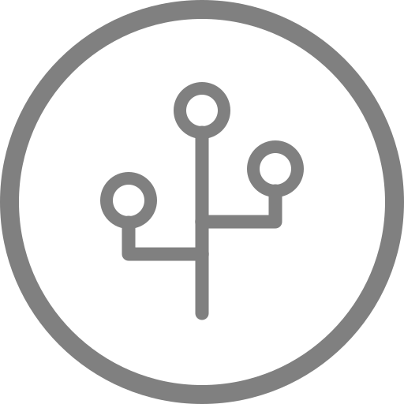

# HA-CoAP Fleet Manager

One application for Windows, macOS and Linux to look after a fleet of ha-coap devices. It finds them on the network, shows their status, draws the Thread mesh they form, builds firmware with the settings you choose, keeps a library of firmware images, and updates devices over the air or over USB.

It runs on your PC when you need it. The app starts a small web server that only this computer can reach (`http://127.0.0.1:8710`), and opens it in your browser. Close the app's window and everything stops.

**Status (2026-10-25):** version 0.1.0, the plan's phases 0–2, 5 and 6 (foundations, inventory, updates, builds, backups and releases), plus a dashboard, device pages with history charts and plant photos, groups, staged updates with signature and battery checks, alerts, a floor plan with a signal heatmap, network history, a channel scan, a serial console and one-click setup of a new computer. Tested against a simulated device on Windows, macOS and Linux, and a real firmware build on Windows, **not yet with real boards**. Runtime settings and commissioning come later (see [the plan](../docs/FLEET-MANAGER-PLAN.md)). Until it has updated real boards, keep using the scripts or the web updater for anything important.

## Getting it

**Packaged app** (no Python needed):
1. Download it:
   - **From a release** (once one is published): the repository's **Releases** page, a `Fleet manager <version>` release, then `hacoap-manager-<version>-<platform>.zip` for Windows (x64), macOS (Apple silicon), Linux (x64) or Linux on ARM (Raspberry Pi 4/5 with a 64-bit OS).
   - **From the latest build of the branch:** the repository's **Actions** tab, the latest **Build firmware** run on the `fleet-manager` branch, then under **Artifacts** `hacoap-manager-Windows-…`, `-macOS-…` or `-Linux-…`.
2. Unzip it.
3. Run it:
   - **Windows:** double-click `hacoap-manager.exe`. SmartScreen warns about an unknown publisher the first time: **More info → Run anyway**.
   - **macOS:** in Terminal, `chmod +x hacoap-manager && xattr -d com.apple.quarantine hacoap-manager && ./hacoap-manager`. Gatekeeper otherwise blocks an unsigned download.
   - **Linux:** `chmod +x hacoap-manager && ./hacoap-manager`.

The app isn't code-signed, which is why each OS warns once.

**From the source** (Python 3.10 or newer), from this folder:

| | Set up once | Start |
|---|---|---|
| Windows (PowerShell) | `py -m venv .venv` then `.venv\Scripts\pip install -r requirements.txt` | `.venv\Scripts\python -m hacoap_manager` |
| macOS, Linux | `python3 -m venv .venv` then `.venv/bin/pip install -r requirements.txt` | `.venv/bin/python -m hacoap_manager` |

Options: `--port 8710` (the next free port is used if it's taken), `--data-dir <folder>`, `--no-browser`.

## Before you use it
- **Same network as the border router.** The PC reaches the devices through the border router, exactly like the scripts: CoAP on UDP 5683 for status, mcumgr on UDP 1337 for updates, and mDNS to find them. If `ping` to a device's address fails from this PC, the app can't reach it either.
- **Images signed with your key.** Build on the PC that has `application/keys/mcuboot-signing-key.pem` (see the main README). An image signed with another key uploads fine, but the board refuses to boot it, and the app reports that MCUboot reverted the update.

## Using it

The look follows [Omarchy](https://omarchy.org/): a terminal feel, JetBrains Mono, and its colour themes, with the ha-coap logo and Home Assistant's blue as the accent in every theme. Tokyo Night is the default; pick another from the menu at the top right, or press **T** to cycle through them (**Shift+T** goes back). The browser remembers the choice, and `?theme=gruvbox` in the address picks one too. Keys **1** to **8** switch tabs. **Ctrl+K** (or **search** at the top) jumps to any tab or device, or runs an action (Find devices, Read the network, download a backup, and so on): type a few letters, then Enter. The status bar at the bottom shows the connection to the app, how many devices are online, what's running (an update's progress, a paused update, a build, a setup step, the console), the open alerts, and a newer version of the app if there is one.

On a phone (over Remote Desktop, say) the layout narrows: the tabs scroll sideways, and two fingers pinch to zoom the network map.

**Dashboard.** The fleet at a glance:
- **Tiles:**
  - devices online
  - plants that need water
  - devices behind the release
  - devices whose firmware was never read
  - low batteries
  - weak links
- **Needs water:** the plants whose soil is under their target, the driest first, with **Run the pump** for each.
- **Alerts:** what needs attention (see Alerts below), each with its time and a button to dismiss it.
- **Firmware:** how many devices run each image, with the release marked. **Update the N behind…** starts a staged update of those devices (see Updates), and **Read all firmware** asks every device which image it runs.
- **Batteries:** the lowest first, with the days left at the current rate. The estimate is a straight line through the last 14 days of readings. It needs at least three readings over six hours, and a battery that is actually going down.
- **Offline:** devices that stopped answering.
- **Weakest links:** from the last network read.
- **Recent updates.**

**Devices.** **Find devices** asks the network for every `ha-coap-*` device (the border router answers for them). You can also add one by its IPv6 address. Each device shows:
- its firmware (the git commit, from `info`)
- the running image's version and hash, once read over mcumgr
- its battery, soil and air readings
- when it last answered

The status refreshes every 15 minutes while the app runs, or with **Refresh all**. Each device's **Actions** menu has:
- Refresh
- Firmware slots (what mcumgr reports)
- Beep
- Rename
- Notes
- Remove

Tick devices to update them, or to use **With selected**: refresh them, read their firmware, beep, add them to a group or remove them from one, set their location or watering target, or remove them from the list, all at once.

- **Groups:** give devices a location and tags (on the device's page, under **About this device**, for example `kitchen` and `herbs`). Click a tag above the list to show only those devices, then tick them all to update one group at a time. The filter box searches names, IDs, addresses, plants, locations, tags and notes.
- **Firmware column:** a badge says whether each device runs the release, an older or other image, or has never been read. **Read all firmware** reads them all.
- **Plants:** a device with a photo shows it next to its name, and a **needs water** badge when its soil is under its target.

**A device's page.** Click a device's name. It shows:
- **Plant:** a photo of the plant it looks after (**Add a photo**: from a phone, too; big photos are shrunk to 1600 pixels before they're sent), and whether it needs water.
- **Status:** its readings, and the days of battery left.
- **Firmware:** what it runs, compared with the release.
- **Controls:**
  - **Run the pump**, **Stop**, and the pump's run time (1 to 9 s)
  - **Beep**

  A command reaches a sleeping board at its next poll: up to 3 s.
- **About this device:** name, plant, location, tags, notes, and **Needs water below**: the soil moisture % under which this plant needs water. Empty uses the default from Settings (30 %); a cactus wants less, a fern more.
- **History:** **CSV** downloads every reading of the device as a spreadsheet. Charts of battery, soil moisture, air humidity, temperature and the link to its parent, over 1, 7, 30 or 90 days, and which parents it had. Every refresh and every network read adds a point, so the charts fill in while the app runs.
- **Updates and network changes:** its own entries from both histories.

**Images.** The library of firmware images. You can add an `app_update.bin` file, or add a build from this computer: when the app runs from the ha-coap-server folder, it lists `application/build*/zephyr/app_update.bin`. Images are identified by their SHA-256 hash, the same one `mcumgr image list` shows. Their version comes from `application/VERSION` (bump it before building a release), and an image built here also records its git commit. Mark one image as the **release**: the image your fleet should run. The dashboard and the device list compare every device with it.

The **Signed** column says who signed each image. The app checks the image's signature against your signing key:
- **your key:** boards with your bootloader boot it.
- **dev key:** signed with MCUboot's public development key, which every build uses when there's no private key. Your boards refuse it.
- **other key:** someone else's key. Your boards refuse it.
- **unsigned:** real boards refuse it. The simulator takes it.
- **not checked:** this computer has never seen your key.

The app keeps the public half of your key in its data folder (it isn't secret), so the check also works on a computer without the private key, once the app has run where the key is. Backups carry it too.

**Network.** A map of the Thread network, read from your border router's REST API (ot-br-posix, port 8081). Set its address on the page (for example `http://192.168.1.20:8081`), or click **Find it** (the app looks for border routers on the LAN), then **Read the network**.
- **What it shows:**
  - every router (the border router as a square) and every child: FTD child, MED (always listening) or SED (sleepy, like your boards)
  - solid lines between routers, and dashed lines from each child to its parent
  - your boards, named, with the ha-coap logo and ringed in the colour of their kind, matched by their IPv6 address
- **Signal strength.** Line colour shows link strength (green, amber, red), and line length follows it: strong links are short, weak ones long. That's radio closeness, not distance, since walls and antennas count. Your boards never link to each other: each one only talks to its parent.
- **What your border router reports depends on its version.**
  - **2025 or later** (`/api/devices`): signal margin and RSSI for every link, and children's addresses, so boards get named.
  - **Older** (`/diagnostics`): link quality 0–3 between routers only, and no addresses for children, so boards show as "SED 0x5c01". The page says which one it got.
- **Interacting:** drag nodes to tidy the map, and click a node or a line for details. Clicking one of your boards (on the mesh or the floor plan) shows its card: the plant's photo, its name, battery (with the days left), soil moisture (and whether it needs water), air humidity and temperature, with **Open its page**, **Run the pump** when it needs water, and **Beep**. The card follows new readings as they come in. Scroll (or pinch) to zoom around the pointer, drag the background to move around, and double-click it or click **fit** to see the whole map again.
- **Changes** logs boards that changed parent between two readings, or disappeared.
- **History:** every reading is kept (the last 1000). Once there are two or more, a **history** slider appears. Drag it to see the network as it was, on the map and on the floor plan, then click **back to latest**. With a border router address set, the app reads the network by itself at every automatic refresh (every 15 minutes), so the history fills in while it runs.
- **Floor plan:** switch the view to **floor plan**, choose a picture of your home (PNG, JPEG or WebP, up to 10 MB), and drag each node to where it really is. The links are drawn between them, coloured by strength, so a weak link shows where a router would help. Drag a node back to the strip on the left to unplace it. It zooms and pans like the mesh. **Signal heatmap** shades the plan with the signal estimated from the placed nodes: each one counts with its strongest link, and the colour fades away from the nodes. Red areas are where a board would struggle, and where a router would help. It's an estimate from a few points, not a measurement: the more nodes you place, the better. The picture is shown at most twice its own size (zoom goes further, up to 4 screen pixels per picture pixel), so use a sharp one: a full-size screenshot or export, not a thumbnail.
- **Channels:** **Scan** has the border router measure the radio noise on every Thread channel (11 to 26) and shows the quietest ones. Wi-Fi shares these frequencies. Changing the channel is done on the border router, and moves the whole network. The scan needs the 2025+ REST API.
- To try it without a border router: `python -m hacoap_manager.simdevice --border-router api` (or `legacy`), then use `http://127.0.0.1:8081`.

**Updates.** Choose an image and either the devices ticked on the Devices tab (over the air) or one board on a USB serial port. Each device goes through these steps:
1. **Connect and read its slots.** A device already running this image is left alone.
2. **Upload** to slot 1, with progress. A lost packet is sent again; the upload doesn't start over.
3. **Test and reset.** MCUboot boots the new image on trial.
4. **Wait for the device to come back** (up to 3 minutes). If it comes back running the old image, MCUboot reverted the update: it's reported as failed, and the device keeps working as before.
5. **Confirm**, so the new image stays.

Before it starts, the app checks the image's signature (see Images). An image your boards would refuse (development key, another key, unsigned) needs a confirmation: say yes only for the simulator, or a board with a development bootloader.

Over the air, a device whose last battery reading is under 20 % (**Lowest battery for an update** in Settings) is skipped, so that it can't die mid-update. The form lists those devices. A skipped device isn't a failure: the others go on. Tick **Update batteries under 20 % too** to include them. Over USB, the board runs from USB power, so there's no check.

Devices are updated one at a time. By default the update stops at the first failure, so a bad image reaches one device, not all of them. **Cancel the rest** skips the devices not started yet; the device in progress finishes, so it's never left half-way. Every result goes into the history.

- **Update one device first, then wait for me:** a staged update. The first device is updated, then the update pauses. Check that device (its readings, its page), then click **Continue with the rest**, or cancel.
- **What's new?** lists the commits between the image the devices run and the chosen one, from the git history of this checkout. It needs both images to have been built here, so their commits are known.

While a device is being updated, it polls its parent every 100 ms instead of every 3 s (firmware on the `claude` branch and later), so uploads aren't slowed by its sleep schedule. Firmware older than that is about three times slower to update.

**Builds.** Builds firmware on this computer, with settings you choose. It needs the app to run from the ha-coap-server folder, which has been set up for building (scripts/setup, see the main README); the packaged app works too if you start it from inside that folder.
- **Build profiles** are named sets of firmware settings: a variant (battery, usb-logging, uart-console or debug) and the values you want to change. The form comes from `application/Kconfig` (the "ha-coap application" options: pump, sensors, LEDs, watchdog, SRP names) plus the Thread poll period. An empty field keeps the firmware's default; only the settings you change are saved, so a profile keeps following the repository's defaults for the rest. The app checks ranges and the rules the firmware enforces (dry soil voltage above wet, and so on) when you save.
- **Build with this profile** runs the repository's own `scripts/build.ps1` or `scripts/build.sh`, exactly as from a terminal, into the variant's usual build folder (`application/build` for battery). The profile's settings go in through a small `.conf` file (`HACOAP_EXTRA_CONF`, which `application/CMakeLists.txt` merges after `local.conf`; a variant's own overlay still wins on the few options it sets). The log streams live, and the finished image goes into the library, named after its profile.
- **Checks** first: the toolchain, the SDK, your signing key and your PSKd. Without your private signing key, the app asks before building with the public development key, and marks such images *DEVELOPMENT KEY*: boards flashed with your bootloader refuse them.
- The PSKd and the signing key never go into profiles: they stay in `application/local.conf` and `application/keys/`.
- **Set up this computer.** On a fresh clone, each failed check has a button. Each button runs the repository's own script (the same one as from a terminal), and its log streams below:
  - **Install the build tools:** runs `scripts/setup`, which installs the nRF Connect toolchain and fetches the SDK into `external/` (about 1 GB, 5 to 15 minutes, once).
  - **Create my signing key:** runs `scripts/keygen`. The app never replaces an existing key. Back the new key up: boards flashed with it only accept images signed with it.
  - **Set my PSKd…:** writes your joiner PSKd into `application/local.conf` (not in git), or generates a random one. Note it down: you need it to commission boards.

  To use these on a new computer: clone the repository, start the app from inside the clone (from the source as above, or the packaged app), open **Builds**, and click the buttons from top to bottom. If you already have a signing key, copy it into `application/keys/` instead of creating one.

**Console.** Shows what a board prints over a USB serial port, live, with a line to send commands. On the **usb-logging** variant, the logs are on the board's second USB serial port (the first one is mcumgr, for updates). On **uart-console**, use a USB-to-UART adapter on J4. The battery variant prints nothing. A port open in the console can't be used for a USB update at the same time: close it first.

**Alerts.** The app raises an alert when:
- a device stops answering (once the app has asked every device since it started)
- a battery is low (20 % or under)
- a plant needs water (soil under its target)
- an update fails

An alert clears by itself when the condition ends; a failed update's stays until dismissed. Alerts show on the dashboard and in the status bar. **Notify me** (dashboard) or **Turn on** (Settings) also pops them up as browser notifications while the page is open, even in a background tab.

**Settings.** Ports, timeouts, the mcumgr packet size (1280 bytes over the air, which fits Thread without IP fragmentation; 512 over USB), how long a device counts as online, the automatic refresh, the lowest battery for an update, the default watering target, and **Check GitHub for app updates**. That last one is off by default. When on, the app asks GitHub once a day whether a newer fleet manager release is out, and says so in the status bar; **Check now** asks once. Under **Data**:
- **Export readings (CSV):** every stored reading of every device.
- **Download a problem report:** one `.zip` to look into a problem or attach to an issue. It has the app's recent log, settings, devices, update and build history (with the last build logs), the alerts and the last network reading. It holds no signing key, and the PSKd is blanked out of every text in it.

## Where things are kept
Everything is in one folder: the SQLite database (devices and their readings, images, update history, build profiles and builds, alerts, network history), the images themselves, `photos/` (the plants), `settings.json`, the public half of your signing key (`signing-public-key.pem`), and `backups/`.

| OS | Folder |
|---|---|
| Windows | `%LOCALAPPDATA%\hacoap-manager` |
| macOS | `~/Library/Application Support/hacoap-manager` |
| Linux | `~/.local/share/hacoap-manager` |

`--data-dir` or the `HACOAP_MANAGER_DATA` environment variable use another one.

## Backups, and moving to another PC
On the **Settings** tab, under **Data**:
- **Download a backup:** one `.zip` with everything (devices, images, history, build profiles, plant photos, the public half of your signing key, settings).
- **Restore:** replaces all the app's data with a backup's. The data it replaces is saved first, as `backups/before-restore-<date>.zip`.
- **Saved backups:** the app makes one automatically once a day while it runs, and keeps the last 7, in the data folder's `backups/`. They're listed there, to download.
- **Export devices (CSV)** gives a spreadsheet of the devices; **Import** adds or updates devices from one, by device ID (name, address and notes; the rest comes from the devices). Handy to label many boards at once.

To move to another PC: download a backup, install the app there, and restore it. Your signing key and PSKd aren't in the backup (the app never holds them): copy `application/keys/` and `application/local.conf` separately, as for building.

## Security
- The server listens on 127.0.0.1 only: other computers on the network can't open it. Using it from another PC is a possible later addition (see the plan).
- Other websites open in the same browser can't use it either. The server only answers requests addressed to 127.0.0.1 or localhost, which blocks DNS rebinding. Every change must carry an `X-HACoap` header, which a page from another site can't add.
- There is no login: anyone using this PC's account can use it.
- The app only contacts the internet if you turn on **Check GitHub for app updates** (or click **Check now**): one request to GitHub's public releases API.
- Pictures (floor plan, plant photos) must be PNG, JPEG or WebP, checked from their content, never SVG, which can carry scripts.
- The devices' mcumgr has no authentication (see the main README's Security section). What protects the boards is the signing key: they only boot images signed with it.

## Trying it without a board
The simulated device answers like a real one: mcumgr over UDP, CoAP, and MCUboot's slots, including reverting an image that isn't confirmed.
```
python -m hacoap_manager.simdevice          # mcumgr on 127.0.0.1:1337, CoAP on 127.0.0.1:5683
```
It also announces itself over mDNS like a real board, so **Find devices** finds it (as `ha-coap-1a2b3c4d` at `127.0.0.1`; `--no-mdns` turns that off), or add it by address `127.0.0.1`. Discovery only accepts a loopback address from the simulator, which marks its announcement as simulated. To try an update, add any `app_update.bin`: the simulator accepts unsigned images too. `--border-router api` adds a simulated border router for the Network page.

A whole fleet: `python -m hacoap_manager.simdevice --count 24 --border-router api` simulates 24 devices at 127.0.0.1 to 127.0.0.24, each with its own readings and battery, every fifth running an older image (v0.9.0). The border router places them all on the map, spread over five routers. Windows and Linux answer on every 127.0.0.x address. macOS needs the extra addresses added first: `for i in $(seq 2 24); do sudo ifconfig lo0 alias 127.0.0.$i up; done`.

## Development

| Path | What |
|---|---|
| `hacoap_manager/app.py` | The web server: API, live events (WebSocket), the page |
| `hacoap_manager/inventory.py` | Discovery, adding devices, refreshing their status |
| `hacoap_manager/updates.py` | Update jobs: upload, test, reset, check, confirm |
| `hacoap_manager/mcumgr.py` | mcumgr over UDP or USB serial, through [smpclient](https://github.com/intercreate/smpclient) |
| `hacoap_manager/coap.py` | A small CoAP client for `info`, `data` and `ping` |
| `hacoap_manager/discovery.py` | mDNS/DNS-SD (zeroconf) |
| `hacoap_manager/mcuboot.py` | Reads an image's version and hash |
| `hacoap_manager/builds.py`, `kconfig.py` | Build profiles (from `application/Kconfig`), checks, the build runner |
| `hacoap_manager/fleet.py` | The dashboard: battery forecasts, release status, plants that need water, weak links |
| `hacoap_manager/alerts.py` | Alerts: raised, cleared, sent to the page |
| `hacoap_manager/signing.py` | Who signed an image: your key, the development key, another one |
| `hacoap_manager/pictures.py` | Plant photos and the floor plan picture: checks and storage |
| `hacoap_manager/report.py` | The problem report, and the recent log it includes |
| `hacoap_manager/appupdate.py` | The check for a newer app release on GitHub |
| `hacoap_manager/setup_tools.py` | The Builds tab's setup buttons (toolchain, signing key, PSKd) |
| `hacoap_manager/console.py` | The serial console |
| `hacoap_manager/backup.py` | Backups, restore, the device list as CSV |
| `hacoap_manager/otbr.py`, `network.py` | The border router's REST API (both generations), the Network page's map and change log |
| `hacoap_manager/simborder.py` | A simulated border router REST API, with a small made-up network |
| `hacoap_manager/db.py` | The SQLite database |
| `hacoap_manager/simdevice.py` | The simulated device |
| `hacoap_manager/static/` | The page: plain JavaScript and Bootstrap, no build step, nothing loaded from the internet |
| `tests/` | Tests against the simulated device, and every tab opened in a headless browser (Chrome, Chromium or Edge, when installed) |

```
pip install -r requirements-dev.txt
python -m pytest            # the tests
python build_app.py         # the packaged app, in dist/
dist/hacoap-manager --self-test
```
CI runs the tests and builds the packaged app on Windows, macOS and Linux (job `fleet-manager`).

**Making a release:**
1. Set the new version in `hacoap_manager/__init__.py` (`__version__`), and describe the changes under a `## <version>` heading at the top of `CHANGELOG.md`.
2. Commit, then tag and push: `git tag manager-v<version>` and `git push origin manager-v<version>`.
3. The **Fleet manager release** workflow tests and packages the app for Windows, macOS, Linux and Linux on ARM, checks that the tag matches the version, and publishes a GitHub release with the zips and the changelog section.

The same workflow can be run by hand from the Actions tab: it then only builds the packages, without a release.

**Not covered by the tests yet:** USB serial (there's no simulated serial port), real Thread timing, and a real border router's REST API (the simulated one follows ot-br-posix's published API and source). They need the hardware. Builds are tested with a stand-in for the build script (CI has no nRF toolchain for the app's tests); a real build through the app was checked on Windows.
